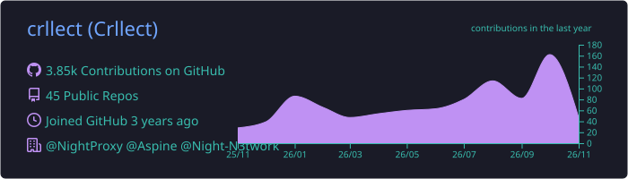

<!-- used colors: 24410c, e70052, 25252a, 141414, ce244c -->

<div align="center">
	<h1>
		Crllect
	</h1>
	 <h3>
		 <i> \krʌˈlɛkt\ </i> <- (CRUH - LLECT)
	 </h3>
</div>

<br />

<br />

### I am always open to collaborating on any projects, so [contact me!](https://crllect.dev/contact/)

- I am a Senior in High School **(17 :o)**
- Co-owner of [Night Network](https://night-network.org), Intern at [Audible](https://www.audible.com/)
- I can speak English and Italian
- I want to go into Forensic Psychiatry
- I live in Cambridge, MA
- ENFJ-T 2w3 so/sx

# Languages, Libraries, and Frameworks I Know
<p align="center">
	<a href="https://skillicons.dev">
		
	</a>
</p>

# What I Use Everyday
<p align="center">
	<a href="https://skillicons.dev">
		
	</a>
</p>

<h1></h1>

<div align="center">
	
</div>

<h1></h1>

<div align="center">
	
</div>

<h1></h1>

<div align="center">
	
</div>

<h1></h1>

### WakaTime Last 7 Days

<!--START_SECTION:waka-->

```txt
From: 24 October 2026 - To: 31 October 2026

Total Time: 0 secs

No activity tracked
```

<!--END_SECTION:waka-->

<h1></h1>

<div align="center">
	<a
		href="https://github.com/ryo-ma/github-profile-trophy"
	>
		
	</a>
</div>

<h1></h1>
<div align="center">
  
  
</div>


<div align="center">
	<div>
		
	</div>
</div>
<h3 align="center">Web Developer</h3>
